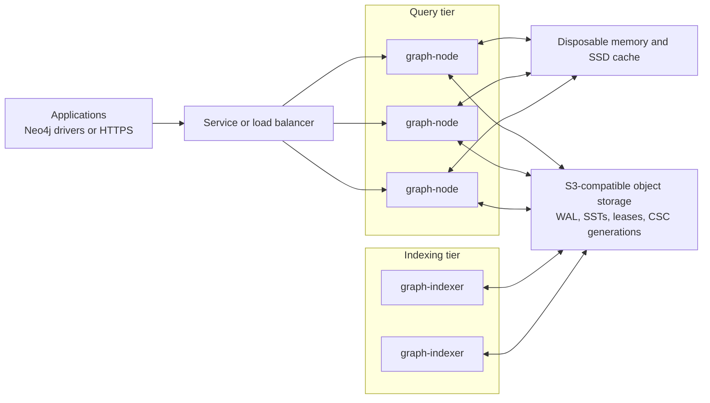

# HydraDB

[](LICENSE)
[](rust-toolchain.toml)
[](https://discord.gg/HcBKJHXmnu)

HydraDB is an object-store-native distributed graph database written in Rust.
It pairs durable graph storage on SlateDB with snapshot-consistent OpenCypher
queries, GraphBLAS traversal, Neo4j-compatible Bolt, and an HTTPS query API.
S3-compatible storage is the source of truth; query nodes and indexers hold
only disposable cache in memory and on local SSD, so they scale and restart
without moving the graph.

Join the community on [Discord](https://discord.gg/HcBKJHXmnu). Contributions
start with an approved issue; see [CONTRIBUTING.md](CONTRIBUTING.md).

## Why HydraDB

- **Object-store durability.** Graph records, WALs, manifests, and immutable
  traversal indexes live in S3-compatible storage.
- **Independent compute.** Query nodes and indexers scale separately and rebuild
  their local caches from durable state.
- **Safe writer handoff.** Object-store CAS leases pick the active writer per
  cell; SlateDB writer epochs fence stale writers.
- **Consistent reads.** Every query runs against one pinned SlateDB snapshot,
  combining a compiled CSC generation with its visible WAL overlay.
- **Graph-native execution.** Property indexes, reverse adjacency, sparse
  traversal, and SuiteSparse GraphBLAS.
- **Familiar clients.** Neo4j drivers over Bolt 5.x, or the typed JSON and
  streaming NDJSON HTTP API.
- **Bounded operation.** Auth, deadlines, result limits, backpressure,
  cancellation, cache budgets, metrics, and traces are part of the runtime.

## Architecture



Query nodes serve reads and canonical mutations. Indexer workers build immutable
CSC generations asynchronously and publish them through atomic object-store
pointers. Readers stay correct when an index is absent or behind because the
visible WAL tail is applied to the indexed base. See
[architecture.md](architecture.md) for the full design.

## Getting Started

### Prerequisites

Rust 1.99+, a C/C++ toolchain, `libcypher-parser`, and SuiteSparse GraphBLAS.

Ubuntu or WSL:

```bash
sudo apt-get update
sudo apt-get install -y \
  build-essential clang libclang-dev cmake pkg-config \
  libcypher-parser-dev libgraphblas-dev \
  curl git python3 python3-venv
```

macOS with Homebrew:

```bash
xcode-select --install
brew install just cmake pkg-config llvm suite-sparse coreutils
brew install cleishm/neo4j/libcypher-parser   # not in homebrew-core

# Rust, if `rustup toolchain list` shows no stable toolchain:
curl --proto '=https' --tlsv1.2 -sSf https://sh.rustup.rs | sh
```

Install Rust from the official installer, not Homebrew: the `rustup` formula is
keg-only and ships no `rustup-init`. [`just`](https://github.com/casey/just) is
the command runner (`cargo install just --locked` if your package manager lacks
it). Docker is optional, used only by the Neo4j-comparison and image-build
harnesses.

### Clone and verify

```bash
git clone https://github.com/hydra-db/hydradb.git
cd hydradb

just native-check   # confirms cypher-parser and GraphBLAS are discoverable
just check          # compiles every default-feature target
```

For an end-to-end runtime check, `bash scripts/runtime_smoke.sh` builds
`graph-node`, starts it, and exercises Bolt and HTTP against a throwaway store.

### Run a local server

Starts a single plaintext development node backed by a local directory. TLS is
required by default in deployed environments and must be disabled explicitly
here.

```bash
mkdir -p .hydradb/store .hydradb/cache
printf '%s\n' 'local-development-token-32-bytes' > .hydradb/auth-token

export CLOUD_PROVIDER=local
export LOCAL_PATH="$PWD/.hydradb/store"
export GRAPH_NAMESPACE=default
export GRAPH_ID=default
export GRAPH_CELL_ID=cell-0
export GRAPH_CELLS=cell-0
export GRAPH_NODE_ID=node-0
export GRAPH_BOLT_NODE_ADDRESSES=node-0=127.0.0.1:7687
export GRAPH_ADVERTISED_BOLT_ADDR=127.0.0.1:7687
export GRAPH_DATA_CACHE_DIR="$PWD/.hydradb/cache"
export GRAPH_AUTH_TOKEN_FILE="$PWD/.hydradb/auth-token"
export GRAPH_ALLOW_PLAINTEXT=true
export RUST_MIN_STACK=33554432   # async query futures overflow the default stack

# macOS only: cargo here does not inherit the justfile's exports.
if command -v brew >/dev/null; then
  export BINDGEN_EXTRA_CLANG_ARGS="-I$(brew --prefix)/include"
  export LIBRARY_PATH="$(brew --prefix)/lib"
fi

cargo run --locked --features server-runtime --bin graph-node
```

The node holds the foreground; run the checks below from a second shell. It
listens on:

| Endpoint | Address | Purpose |
|---|---|---|
| Bolt | `127.0.0.1:7687` | Neo4j-driver-compatible queries |
| HTTP | `127.0.0.1:8443` | JSON and NDJSON query API |
| Admin | `127.0.0.1:9090` | readiness and Prometheus metrics |

Write and read a small graph over HTTP:

```bash
TOKEN='local-development-token-32-bytes'

curl -sS http://127.0.0.1:8443/v1/graphs/default/query \
  -H "Authorization: Bearer $TOKEN" \
  -H 'X-Graph-Namespace: default' \
  -H 'Content-Type: application/json' \
  --data '{"cell_id":"cell-0","query":"CREATE (a {id: 1})-[:FOLLOWS]->(b {id: 2})"}'

curl -sS http://127.0.0.1:8443/v1/graphs/default/query \
  -H "Authorization: Bearer $TOKEN" \
  -H 'X-Graph-Namespace: default' \
  -H 'Content-Type: application/json' \
  --data '{"cell_id":"cell-0","query":"MATCH (a {id: 1})-[:FOLLOWS]->(b) RETURN b.id AS id"}'
```

The second call returns one row with `{"type":"vertex_id","value":2}`.

### Opt in to DataFusion

`GRAPH_CYPHER_ENGINE=legacy|experimental|datafusion` selects the query engine,
not a storage backend. The default is `legacy`; all three share the same
SlateDB graph, so switching needs no data migration.

DataFusion requires the `datafusion-cypher-engine` build feature. With the local
server environment above exported, replace its `cargo run` with:

```bash
just build-datafusion-node
export GRAPH_CYPHER_ENGINE=datafusion
target/debug/graph-node
```

A binary built without the feature rejects `datafusion` at startup. DataFusion
does not yet support every query shape: `DETACH DELETE` and multi-row mutations
needing clause-major execution are rejected before durable effects rather than
falling back mid-execution.

`GRAPH_CYPHER_MUTATION_ATOMICITY=legacy_chunked|statement` selects mutation
atomicity (default `legacy_chunked`). Earlier chunk checkpoints can survive a
failed statement and must be resumed on their originating engine.

### Troubleshooting local runs

| Symptom | Cause and fix |
|---|---|
| `No available formula with the name "libcypher-parser"` | Use the tap: `brew install cleishm/neo4j/libcypher-parser` |
| `command not found: rustup-init` | Homebrew's `rustup` is keg-only and ships no `rustup-init`; use the official installer |
| `invalid environment variable CLOUD_PROVIDER value \`null\`` | `CLOUD_PROVIDER` unset — `null` means absent. `local` also needs `LOCAL_PATH` at an existing directory |
| `wrapper.h:4:10: fatal error: 'cypher-parser.h' file not found` | `BINDGEN_EXTRA_CLANG_ARGS` unset on macOS; prefer `just`, which exports it |
| Node answers `/readyz`, then aborts with `has overflowed its stack` | `RUST_MIN_STACK` unset; export `33554432` |
| `curl: (7) Failed to connect ... port 9090` | The node is not running. `graph-node` holds the foreground; start it in its own shell |

## MCP

`just mcp-local` runs a local node, indexer, and stdio MCP server. The
`hydradb-mcp` crate exposes graph queries to agent clients over the Model
Context Protocol with `execute_query` (Cypher plus `tenant`, `subtenant`,
optional parameters, and explicit HTTP pagination); the first write creates the
scope. See the crate source for client configuration.

Failed-query reporting to a separate HTTP receiver and ClickHouse is opt-in via
the `hydradb-query-telemetry` crate and `GRAPH_QUERY_TELEMETRY_ENABLED`.

## Querying

HydraDB supports a practical OpenCypher subset for reads and mutations:
typed relationships, bounded variable-length paths, property and label
predicates, ordering, pagination, aggregation, `OPTIONAL MATCH`, `UNION`, and
batched `UNWIND` writes.

Connect with a Neo4j driver using a routed URI:

```text
neo4j://127.0.0.1:7687
```

Use `neo4j+s://` with a trusted certificate or `neo4j+ssc://` for a self-signed
one. Direct `bolt://` addresses are for diagnostics; clustered clients should
use routing.

### Native path procedures

Snapshot-scoped path procedures run over compiled GraphBLAS topology with the
visible WAL overlay and bounded metadata hydration:

- `algo.SPpaths` — bounded paths between one source and one target.
- `algo.SSpaths` — bounded paths from one source.
- `algo.MSpaths` — resolves many indexed source and target values together,
  avoiding client-side fan-out.

```cypher
CALL algo.MSpaths({
  sourceLabel: 'Entity',
  sourceProperty: 'name',
  sourceValues: ['alpha', 'beta', 'gamma'],
  targetValues: ['alpha', 'beta', 'gamma'],
  pairwise: true,
  relTypes: ['RELATES'],
  relDirection: 'both',
  maxLen: 3,
  pathCount: 5,
  fairRelationshipVariants: true,
  resultLimit: 100
})
YIELD path
RETURN path
```

`algo.degree` ranks the vertices of one label by relationship degree from the
same topology, without expanding relationships through Cypher:

```cypher
CALL algo.degree({
  label: 'Entity',
  relTypes: ['RELATES'],
  relDirection: 'both',   // 'outgoing' | 'incoming' | 'both' (default) | 'undirected'
  neighborLabel: 'Entity', // optional: count only relationships to this label
  minDegree: 50,          // default 0
  limit: 100              // default and maximum: max_query_result_vertices
})
YIELD node, degree
RETURN node.entity_id AS entity_id, node.name AS name, node.type AS type, degree
```

`degree` matches `MATCH (n:Entity)-[r:RELATES]->() RETURN count(r)` plus its
incoming mirror: each parallel relationship counts, and a self-loop counts twice
under `both`. `undirected` counts every relationship touching the vertex once.
`neighborLabel` restricts to relationships whose other endpoint carries that
label. Rows are ordered by degree descending, then vertex id; `minDegree`,
`limit`, `label`, `neighborLabel`, and `relDirection` accept `$parameters`.

## Read Consistency

| Mode | Behavior |
|---|---|
| `causal` | Default hot path. Uses the node's current durable reader view, refreshing when a bookmark requires a newer sequence. |
| `strong` | Refreshes the SlateDB reader from object storage before pinning the snapshot, paying the freshness cost. |

HTTPS requests set `"consistency"` in the body. Bolt clients set `consistency`
in `RUN` metadata or `hydradb.consistency` in transaction metadata; the former
`turbolay.consistency` key remains accepted as an alias.

## Kubernetes

The Helm chart deploys query nodes, indexer workers, services, cache volumes,
network policies, disruption budgets, TLS, authentication, and optional
Prometheus integration.

```bash
helm upgrade --install hydradb charts/hydradb \
  --namespace hydradb \
  --create-namespace \
  --values charts/hydradb/examples/values-eks.yaml \
  --atomic \
  --timeout 15m
```

Copy and edit the example values first — credentials, bucket names, image
references, TLS, advertised Bolt addresses, and workload identity are
environment-specific. See the [Helm chart guide](charts/hydradb/README.md).

## Observability

The public HTTP server exposes `GET /healthz`; graph-node and indexer admin
servers expose `GET /readyz` and `GET /metrics`. Build with
`--features server-runtime,otlp` or `--features indexer-runtime,otlp` to export
OpenTelemetry data.

Prometheus duration histograms use mixed units stated only in the metric name:
`_seconds` for client operation latencies, `_microseconds` for the bookmark-wait,
query, mutation-batch, and query-transport histograms. Check the suffix before
building alerts, and never compare series across the two.

## Development

Run `just` or `just help` for the full command surface; recipes run from the
repository root.

### Verification Recipes

| Recipe | Coverage |
|---|---|
| `just native-check` | Verifies `cypher-parser` and GraphBLAS are discoverable |
| `just fmt`, `just fmt-check` | Format or check formatting |
| `just clippy`, `just clippy-native`, `just clippy-runtime` | Default, full-native, and runtime lint configurations |
| `just check`, `just check-all-features` | Check default-feature targets, or every feature |
| `just check-examples` | Check example targets under their supported features |
| `just ci` | Full local CI-equivalent sequence (tens of minutes) |

### Scripts

| Script | Behavior |
|---|---|
| `scripts/runtime_smoke.sh` | Builds `graph-node` and exercises Bolt, scoped databases, HTTP, and shutdown; requires Python `neo4j` |
| `scripts/install_lagraph.sh` | Builds and installs LAGraph on GraphBLAS; used by the release workflow and Docker build |

The openCypher TCK runner scripts live under `query-language/` and are driven by
the `just tck-*` recipes. Benchmark, stress, chaos, fencing, RustFS, and
deployment harnesses are maintained separately in
[hydra-db/benchmark](https://github.com/hydra-db/benchmark).

`just update-slatedb` updates the pinned SlateDB dependency in `Cargo.lock`;
review the lockfile diff before committing.

### Repository layout

```text
src/core/           configuration, graph model, cache policy, errors
src/shard/          storage lifecycle, reads, writes, queries, path procedures
src/engine/         routing, placement, immutable indexes, index GC
src/query/          OpenCypher parsing, algebra, planning, transport types
src/client/         Bolt, HTTP, authentication, quotas, cursors
src/sparse_kernel/  Rust sparse and SuiteSparse GraphBLAS execution
crates/             placement and telemetry workspace crates
charts/hydradb/     Kubernetes Helm chart
examples/           smoke, import, benchmark, and correctness programs
scripts/            LAGraph install helper and the runtime smoke test
query-language/     openCypher and GQL grammar, harness, and the TCK suite
```

## Benchmarks

Published results are on the
[HydraDB benchmark site](https://hydra-db.github.io/benchmark/). The harness and
its scripts live in [hydra-db/benchmark](https://github.com/hydra-db/benchmark);
see its README and `METHODOLOGY.md` to reproduce measurements locally or against S3.

## Documentation

| Document | Contents |
|---|---|
| [Architecture](architecture.md) | Design, snapshots, writer ownership, query execution, indexing |
| [Using HydraDB](USING-HYDRADB.md) | Getting started, querying, operating, and running the benchmarks |
| [OpenCypher subset](cypher-compat.md) | What the engine accepts and rejects at parse time |
| [Helm chart guide](charts/hydradb/README.md) | Kubernetes configuration, TLS, auth, upgrades |
| [Agent notes](AGENTS.md) | How to build, run, and not trip over `RUST_MIN_STACK` |

## Contributing

Issues and pull requests are welcome. Keep changes focused, add regression
coverage for behavioral changes, and run `just ci` before opening a PR. Changes
to storage, fencing, snapshots, routing, or index publication should state the
invariant they preserve and include a failure-oriented test.

## License

HydraDB is licensed under the [Elastic License 2.0 (ELv2)](LICENSE).
