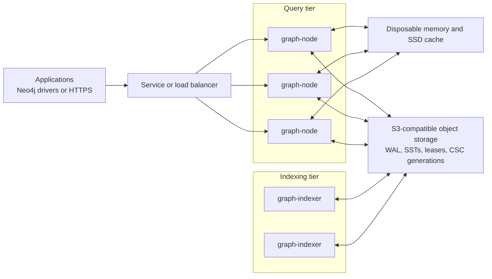

# HydraDB

[](https://github.com/hydra-db/hydradb/actions/workflows/opencypher-tck.yml)
[](https://github.com/hydra-db/hydradb/releases)
[](LICENSE)
[](rust-toolchain.toml)
[](https://hydra-db.github.io/benchmark/)
[](https://discord.gg/HcBKJHXmnu)

HydraDB is an object-store-native distributed graph database written in Rust.
It pairs durable graph storage on SlateDB with snapshot-consistent OpenCypher
queries, GraphBLAS traversal, Neo4j-compatible Bolt, and an HTTPS query API.
S3-compatible storage is the source of truth; query nodes and indexers hold
only disposable cache in memory and on local SSD, so they scale and restart
without moving the graph.

Join the community on [Discord](https://discord.gg/HcBKJHXmnu). Contributions
start with an approved issue; see [CONTRIBUTING.md](CONTRIBUTING.md).

## Why HydraDB

- **Object-store durability.** Graph records, WALs, manifests, and immutable
  traversal indexes live in S3-compatible storage.
- **Independent compute.** Query nodes and indexers scale separately and rebuild
  their local caches from durable state.
- **Safe writer handoff.** Object-store CAS leases pick the active writer per
  cell; SlateDB writer epochs fence stale writers.
- **Consistent reads.** Every query runs against one pinned SlateDB snapshot,
  combining a compiled CSC generation with its visible WAL overlay.
- **Graph-native execution.** Property indexes, reverse adjacency, sparse
  traversal, and SuiteSparse GraphBLAS.
- **Familiar clients.** Neo4j drivers over Bolt 5.x, or the typed JSON and
  streaming NDJSON HTTP API.
- **Bounded operation.** Auth, deadlines, result limits, backpressure,
  cancellation, cache budgets, metrics, and traces are part of the runtime.

## Architecture



Query nodes serve reads and canonical mutations. Indexer workers build immutable
CSC generations asynchronously and publish them through atomic object-store
pointers. Readers stay correct when an index is absent or behind because the
visible WAL tail is applied to the indexed base. See
[architecture.md](architecture.md) for the full design.

## Getting Started

### Prerequisites

Rust 1.99+, a C/C++ toolchain, `libcypher-parser`, and SuiteSparse GraphBLAS.
[`just`](https://github.com/casey/just) runs the recipes. On Ubuntu or WSL:

```bash
sudo apt-get install -y build-essential clang libclang-dev cmake pkg-config \
  libcypher-parser-dev libgraphblas-dev curl git python3 python3-venv
```

On macOS: `brew install just cmake pkg-config llvm suite-sparse` and
`brew install cleishm/neo4j/libcypher-parser`. Install Rust from
[rustup.rs](https://rustup.rs), not Homebrew. [AGENTS.md](AGENTS.md) has the full
native-dependency setup and the common build and startup failure modes.

### Build and verify

```bash
git clone https://github.com/hydra-db/hydradb.git
cd hydradb

just native-check   # confirms cypher-parser and GraphBLAS are discoverable
just check          # compiles every default-feature target
```

`bash scripts/runtime_smoke.sh` then builds `graph-node`, starts it, and
exercises Bolt and HTTP against a throwaway store, printing `runtime-smoke-ok`.

### Run a local node

A single plaintext development node on a local directory. TLS is required in
deployed environments and disabled explicitly here.

> **`CLOUD_PROVIDER=local` is for smoke tests, not sustained writes.** The
> `local` backend stores through `LocalFileSystem`, which does not implement
> conditional puts (`put_opts` with `PutMode::Update`). Manifest garbage
> collection needs them, so under a sustained write load GC begins failing and
> does not recover — logged at `ERROR` as
> `error collecting garbage [resource=Manifest, error=ObjectStoreError(NotImplemented ...)]`.
> Reads and `/readyz` keep succeeding while this happens, so the node looks
> healthy. For anything beyond a smoke test, point the node at an S3-compatible
> object store instead — `CLOUD_PROVIDER=aws` with `AWS_BUCKET_NAME`,
> `AWS_DEFAULT_REGION`, and, for a local MinIO, `AWS_ENDPOINT` plus
> `AWS_ALLOW_HTTP=true`. `CLOUD_PROVIDER` accepts `local`, `memory`, `aws`,
> `azure` and `gcp`; `memory` is also fine for a throwaway smoke test where
> durability does not matter. See the
> [Helm chart guide](charts/hydradb/README.md) for the full object-store surface,
> and [#81](https://github.com/hydra-db/hydradb/issues/81) for the reproduction.

```bash
mkdir -p .hydradb/store .hydradb/cache
printf '%s\n' 'local-development-token-32-bytes' > .hydradb/auth-token

export CLOUD_PROVIDER=local LOCAL_PATH="$PWD/.hydradb/store"
export GRAPH_NAMESPACE=default GRAPH_ID=default GRAPH_CELL_ID=cell-0 GRAPH_CELLS=cell-0
export GRAPH_NODE_ID=node-0 GRAPH_BOLT_NODE_ADDRESSES=node-0=127.0.0.1:7687
export GRAPH_ADVERTISED_BOLT_ADDR=127.0.0.1:7687
export GRAPH_DATA_CACHE_DIR="$PWD/.hydradb/cache"
export GRAPH_AUTH_TOKEN_FILE="$PWD/.hydradb/auth-token" GRAPH_ALLOW_PLAINTEXT=true
export RUST_MIN_STACK=33554432

cargo run --locked --features server-runtime --bin graph-node
```

It listens on Bolt `127.0.0.1:7687`, HTTP `127.0.0.1:8443`, and admin
`127.0.0.1:9090`. The node holds the foreground; from a second shell, write and
read a small graph over HTTP:

```bash
TOKEN='local-development-token-32-bytes'

curl -sS http://127.0.0.1:8443/v1/graphs/default/query \
  -H "Authorization: Bearer $TOKEN" -H 'X-Graph-Namespace: default' \
  -H 'Content-Type: application/json' \
  --data '{"cell_id":"cell-0","query":"CREATE (a {id: 1})-[:FOLLOWS]->(b {id: 2})"}'

curl -sS http://127.0.0.1:8443/v1/graphs/default/query \
  -H "Authorization: Bearer $TOKEN" -H 'X-Graph-Namespace: default' \
  -H 'Content-Type: application/json' \
  --data '{"cell_id":"cell-0","query":"MATCH (a {id: 1})-[:FOLLOWS]->(b) RETURN b.id AS id"}'
```

The second call returns one row with `{"type":"vertex_id","value":2}`.

## Querying

HydraDB speaks a practical OpenCypher subset for reads and mutations: typed
relationships, bounded variable-length paths, property and label predicates,
ordering, pagination, aggregation, `OPTIONAL MATCH`, `UNION`, and batched
`UNWIND` writes. Connect with a Neo4j driver over a routed URI
(`neo4j://127.0.0.1:7687`; `neo4j+s://` with a trusted certificate).

Snapshot-scoped native path and degree procedures (`algo.SPpaths`,
`algo.SSpaths`, `algo.MSpaths`, `algo.degree`) run over compiled GraphBLAS
topology. The query surface, worked examples, and read-consistency modes are in
[USING-HYDRADB.md](USING-HYDRADB.md) and the
[OpenCypher subset](cypher-compat.md).

## Kubernetes

The Helm chart deploys query nodes, indexer workers, services, cache volumes,
network policies, disruption budgets, TLS, authentication, and optional
Prometheus integration.

```bash
helm upgrade --install hydradb charts/hydradb \
  --namespace hydradb --create-namespace \
  --values charts/hydradb/examples/values-eks.yaml \
  --atomic --timeout 15m
```

Copy and edit the example values first; credentials, buckets, image references,
TLS, and advertised Bolt addresses are environment-specific. See the
[Helm chart guide](charts/hydradb/README.md).

## Observability

The public HTTP server exposes `GET /healthz`; graph-node and indexer admin
servers expose `GET /readyz` and `GET /metrics`. Build with `otlp` added to the
feature set to export OpenTelemetry data. Duration histograms state their unit
in the metric name (`_seconds` vs `_microseconds`); do not compare across the
two. The optional failed-query telemetry sink is described in
[crates/query-telemetry/README.md](crates/query-telemetry/README.md).

## Development

Run `just` for the full command surface; recipes run from the repository root.
`just ci` runs the local CI-equivalent sequence. The openCypher TCK runner lives
under `query-language/` behind the `just tck-*` recipes. Benchmark, stress,
chaos, and deployment harnesses are maintained separately in
[hydra-db/benchmark](https://github.com/hydra-db/benchmark).

```text
src/core/           configuration, graph model, cache policy, errors
src/shard/          storage lifecycle, reads, writes, queries, path procedures
src/engine/         routing, placement, immutable indexes, index GC
src/query/          OpenCypher parsing, algebra, planning, transport types
src/client/         Bolt, HTTP, authentication, quotas, cursors
src/sparse_kernel/  Rust sparse and SuiteSparse GraphBLAS execution
crates/             placement and telemetry workspace crates
charts/hydradb/     Kubernetes Helm chart
query-language/     openCypher and GQL grammar, harness, and the TCK suite
```

## Documentation

| Document | Contents |
|---|---|
| [Architecture](architecture.md) | Design, snapshots, writer ownership, query execution, indexing |
| [Using HydraDB](USING-HYDRADB.md) | Connecting, the OpenCypher dialect, path queries, query engines, consistency, operating |
| [OpenCypher subset](cypher-compat.md) | What the engine accepts and rejects at parse time |
| [Helm chart guide](charts/hydradb/README.md) | Kubernetes configuration, TLS, auth, upgrades |

## Benchmarks

Published results are on the
[HydraDB benchmark site](https://hydra-db.github.io/benchmark/); the harness
lives in [hydra-db/benchmark](https://github.com/hydra-db/benchmark).

## Contributing

Issues and pull requests are welcome. Keep changes focused, add regression
coverage for behavioral changes, and run `just ci` before opening a PR. Changes
to storage, fencing, snapshots, routing, or index publication should state the
invariant they preserve and include a failure-oriented test.

## License

HydraDB is licensed under the [Elastic License 2.0 (ELv2)](LICENSE).
